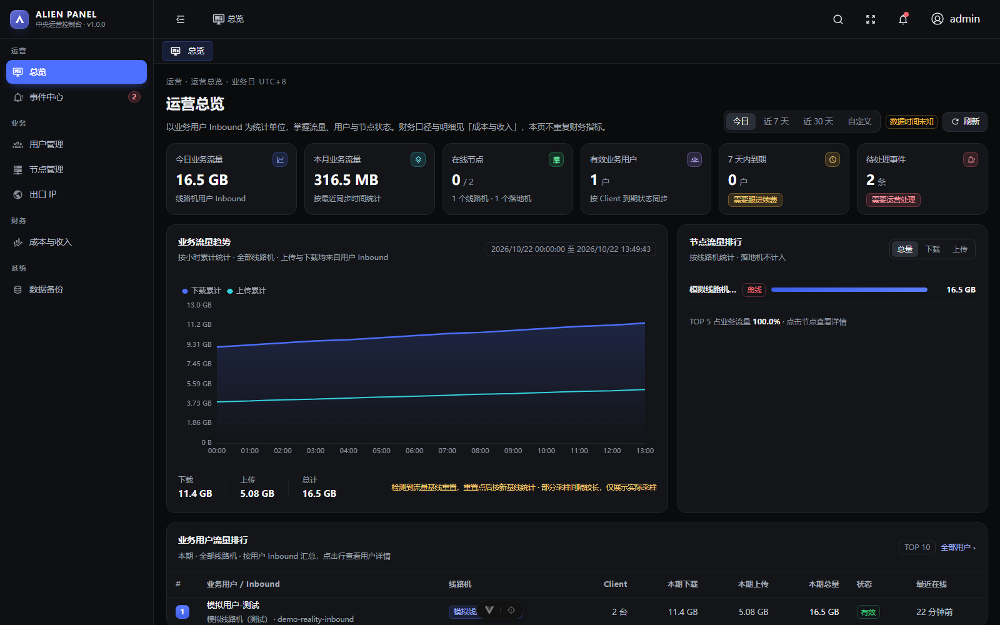

# Alien-Panel

多节点 X-Panel 运营控制台。中央服务以只读方式采集各节点 X-Panel 的业务数据，统一呈现用户、节点、出口 IP、财务与事件，**不向 X-Panel / Xray 写入任何配置**。

当前版本 **v2.0.8**，节点 Agent **v1.0.4**。



---

## 技术栈

| 层 | 技术 | 版本 / 说明 |
|---|---|---|
| 前端框架 | Vue 3.5 + TypeScript 6.0 | 全面 TS，`vue-tsc` 3.2 类型检查 |
| 前端 UI | Naive UI 2.44 | 通过 `theme-overrides` 统一主题 |
| 前端脚手架 | Soybean Admin（vendored） | `@sa/axios`、`@sa/hooks`、`@sa/materials` 等以 workspace 包形式内置在 `frontend/packages/` |
| 状态管理 | Pinia 3.0 | |
| 路由 | Vue Router 5.0 | 静态路由 + 动态菜单 |
| 图表 | ECharts 6.0 | 按需引入 |
| 样式 | UnoCSS 66 + 原生 CSS 变量 | 原子类 + 语义 token |
| 图标 | `@iconify/vue` + MDI | 统一 `SvgIcon` 组件封装 |
| 构建 | Vite 8 + pnpm | 生产构建输出静态资源 |
| 中央服务 | Go 1.27 | `net/http` 标准库路由（Go 1.22+ `ServeMux` 支持方法与路径参数） |
| 数据库 | SQLite（`modernc.org/sqlite` 1.39） | 纯 Go 实现，无 CGO；WAL 模式 |
| 数据库模式 | 版本化迁移 | `001` → `027`，启动时幂等执行 |
| 节点 Agent | Go 1.27 | 静态编译（`CGO_ENABLED=0`），systemd 托管 |
| 部署编排 | Docker Compose | central + 内置 Nginx 两个容器 |
| 反向代理 | 宿主机 Nginx / Caddy | 终止 HTTPS 并转发到 `127.0.0.1:18080` |
| 发布 | 预编译二进制 + 校验清单 | SHA-256，`install.sh` 一键安装 |

### 代码结构

```text
backend/
  cmd/server/            中央服务入口
  cmd/db-maintenance/    backup / restore / verify / traffic-rollup CLI
  cmd/traffic-check/     流量汇总校验
  cmd/seed-demo/         本地演示数据
  internal/config/       环境变量与配置
  internal/db/           连接、迁移、备份、恢复
  internal/httpapi/      HTTP 层：路由、鉴权、业务查询

agent/
  cmd/agent/             Agent 入口
  internal/collector/    X-Panel 只读采集（Inbound / Client / 流量 / 配额）
  internal/xpanel/       X-Panel Session API 客户端
  internal/central/      中央服务上报客户端
  internal/runner/       同步循环、重试、退避
  internal/retry/        重试策略
  internal/config/       agent.yaml + 环境变量

frontend/src/
  views/                 8 个业务页面
  layouts/               外壳、侧栏、顶栏、标签栏、搜索
  service/api/           接口封装
  store/                 Pinia 状态
  styles/css/            设计 token 与全局样式
  typings/api/           接口类型定义

deploy/                  Dockerfile、Compose、Nginx/Caddy、备份恢复脚本、构建脚本
release/                 预编译二进制与 SHA-256
checksums/               发布文件与源码校验清单
docs/                    架构、业务口径、数据库、部署、运维、性能、发布
```

---

## 架构

```text
        ┌───────────────┐        HTTPS / Bearer Token        ┌──────────────────┐
        │  节点 A        │ ────────────────────────────────▶ │                  │
        │  X-Panel      │   POST /api/agent/v1/heartbeat     │   中央服务        │
        │  Agent        │   POST /api/agent/v1/sync          │   Go + SQLite    │
        └───────────────┘                                    │                  │
        ┌───────────────┐                                    │  ┌────────────┐  │
        │  节点 B        │ ──────────────────────────────────▶ │  │ panel.db   │  │
        │  X-Panel      │                                    │  └────────────┘  │
        │  Agent        │                                    │                  │
        └───────────────┘                                    └────────┬─────────┘
                                                                      │ REST / JSON
                                                             ┌────────▼─────────┐
                                                             │  Vue 3 管理前端   │
                                                             │  （Nginx 静态托管）│
                                                             └──────────────────┘
```

- **采集方向单向**：Agent 从节点本机 X-Panel 的 Session API 读取数据，推送到中央；中央从不反向写入
- **Agent 默认 60 秒同步一次**，失败按指数退避重试；心跳与快照分离，心跳轻量、快照幂等
- **中央按节点去重**：Inbound 以 `(node_id, remote_inbound_id)` 唯一，Client 以 `(node_id, inbound_id, remote_client_id)` 唯一，重复上报只更新不新增
- **业务用户建模**：一台线路机上的一个用户 Inbound = 一个业务用户；Client / Email 是设备凭证，不同 Inbound 或节点的相同 Email 不合并

### 数据流

```text
X-Panel Session API
   │  ① Agent 采集：Inbound 列表、Client 列表、到期时间、流量、配额
   ▼
Agent（本机）
   │  ② 组装快照：node_key + sync_id + observed_at + inbounds/clients
   ▼
POST /api/agent/v1/sync（幂等）
   │  ③ 中央事务写入：inbounds / clients / traffic_snapshots / sync_runs
   ▼
SQLite（WAL 模式）
   │  ④ 增量写入小时级流量汇总：traffic_hourly_rollups（同步事务内完成）
   ▼
前端查询接口
   │  ⑤ /dashboard、/users、/nodes、/costs/summary、/events …
   ▼
Vue 前端渲染
```

---

## 页面与功能

| 页面 | 路由 | 主要能力 |
|---|---|---|
| 总览 | `/dashboard` | 6 个全局 KPI、流量趋势（小时/天，7 天与 30 天）、节点流量排行、业务用户流量排行、到期分布 |
| 事件中心 | `/events` | 4 个 KPI、类型分布、多维筛选、标记已读、处理事件 |
| 用户管理 | `/users` | 分组/表格双视图、业务资料抽屉、订单核验与取消、续费确认、路径配置、CSV 导入导出 |
| 节点管理 | `/nodes` | 节点 KPI、卡片网格、接入向导（自动解析 X-Panel 地址）、请求同步、停用、删除 |
| 节点详情 | `/nodes/:id` | 元数据、Inbound 列表、出口 IP、同步运行记录、节点成本、重新生成部署命令 |
| 出口 IP | `/exit-ips` | 资产 KPI、地区分布、S5 独立 IP 与节点公网出口台账、关联用户、有效期与月成本 |
| 成本与收入 | `/finance` | 7 个财务 KPI、收入成本趋势、收款订单、续费分析、成本明细 |
| 数据备份 | `/system/backup` | 手动备份、记录列表、完整性校验、删除、下载、恢复、CLI 命令 |

### 财务口径

- 财务月按 **UTC+8（北京时间）** 计算，与业务日一致
- **服务期收入**：订单金额按服务期与月份交集按秒分摊（应计口径）
- **现金收款**：`paid_at` 在本月的已确认、已核验订单（收付实现口径）
- `毛利 = 服务期收入 − 本月成本`，`现金余额 = 现金收款 − 本月成本`
- 续费率分母只取本期到期的收费用户

---

## 数据模型

26 张表，分五类：

| 类别 | 表 |
|---|---|
| 节点与凭证 | `nodes`、`node_credentials`、`node_events`、`node_install_tokens`、`node_costs` |
| X-Panel 采集 | `inbounds`、`clients`、`user_inbounds`、`traffic_snapshots`、`traffic_hourly_rollups`、`traffic_rollup_state`、`traffic_rollup_dirty_buckets`、`sync_runs` |
| 业务与财务 | `users`、`user_billing_records`、`user_renewal_candidates`、`other_costs` |
| 出口与路径 | `exit_ips`、`routes`、`route_exit_ips`、`user_paths`、`user_path_exit_ips`、`user_routes` |
| 系统 | `admin_users`、`sessions`、`audit_logs` |

迁移文件位于 `backend/internal/db/migrations/`，服务启动时按文件名顺序幂等执行。

---

## HTTP 接口

68 个路由，按前缀分组：

| 前缀 | 数量 | 说明 |
|---|---|---|
| `/api/users` | 16 | 用户列表、详情、计费记录、续费、路径、绑定 |
| `/api/nodes` | 10 | 节点 CRUD、同步、部署命令、成本 |
| `/api/routes` | 9 | 线路与出口绑定 |
| `/api/events` | 7 | 事件列表、统计、已读、处理 |
| `/api/exit-ips` | 6 | 出口 IP 台账与关联用户 |
| `/api/system` | 6 | 备份列表/创建/校验/删除/下载、恢复 |
| `/api/auth` | 4 | 登录、登出、当前用户 |
| `/api/agent` | 4 | Agent 心跳与快照上报 |
| 其他 | 6 | `/dashboard`、`/costs/summary`、`/costs/trend`、`/billing/import`、`/renewal-candidates`、`/inbounds/:id/reset-user` |

完整契约见 [`backend/openapi.yaml`](backend/openapi.yaml)。

鉴权：管理员使用 Bearer Session Token；Agent 使用节点级 Token，仅在注册时下发一次。

---

## 部署

要求：Linux amd64（Ubuntu/Debian 22.04+），root 权限。服务器不需要 Go / Node.js / pnpm。

```bash
curl -fsSL https://raw.githubusercontent.com/Arm0ne/Alien-Panel/v2.0.8/install.sh | sudo bash -s -- \
  --repo https://github.com/Arm0ne/Alien-Panel.git \
  --ref v2.0.8 \
  --domain panel.example.com
```

脚本流程：安装 Docker Compose → 下载并校验发布包（`checksums/release.sha256`）→ 安装到 `/opt/alien-panel` → 生成随机管理员密码与 Agent 引导 Token（`.env`，权限 `0600`）→ 启动 central + Nginx 容器。

| 模式 | 监听 | 用途 |
|---|---|---|
| `--domain panel.example.com` | `127.0.0.1:18080` | 生产，由宿主机 Nginx/Caddy 终止 HTTPS |
| 不带 `--domain` | `0.0.0.0:18080` | 临时公网验证 |

宿主机反代模板：`deploy/nginx.conf`、`deploy/Caddyfile`。必须转发 `/api/`、`/agent/` 与健康检查路径，并设置 `X-Forwarded-Proto https`。

首次凭据：`sudo cat /opt/alien-panel/.env`

### 升级

重跑同一条命令并更换 `--ref`，`.env` 与 Docker 数据卷保留：

```bash
curl -fsSL https://raw.githubusercontent.com/Arm0ne/Alien-Panel/v2.0.8/install.sh | sudo bash -s -- \
  --repo https://github.com/Arm0ne/Alien-Panel.git --ref v2.0.8 --domain panel.example.com
```

> 不要执行 `docker compose down -v`，该命令会删除数据卷。

### 备份与恢复

```bash
# 手动备份（服务端留存）
docker run --rm -v alien-panel_central-data:/data \
  -v /opt/alien-panel/release/xpanel-db-maintenance:/usr/local/bin/xpanel-db-maintenance:ro \
  alpine:3.22 /usr/local/bin/xpanel-db-maintenance backup \
  --database /data/panel.db --backup-dir /data/backups --retention 14

# 恢复（先停服务）
docker run --rm -v alien-panel_central-data:/data \
  -v /opt/alien-panel/release/xpanel-db-maintenance:/usr/local/bin/xpanel-db-maintenance:ro \
  -v /root/backup.sqlite3:/backup.sqlite3:ro \
  alpine:3.22 /usr/local/bin/xpanel-db-maintenance restore \
  --source /backup.sqlite3 --database /data/panel.db --yes
```

面板「数据备份」页也提供备份记录、完整性校验、删除与恢复入口。

---

## 节点 Agent

### 接入

在面板「节点管理 → 接入新节点」生成一次性安装命令（Token 15 分钟有效、不可复用）。安装脚本会校验 SHA-256、创建 `xpanel-agent` 系统用户、写入 `/etc/xpanel-agent/agent.yaml`（`0600`）并注册 systemd 服务。

### 配置示例

```yaml
node_key: node-xxxxxxxx
central_url: https://panel.example.com/api
central_token: ****
xpanel_url: http://127.0.0.1:2053
xpanel_base_path: /
xpanel_username: ****
xpanel_password: ****
sync_interval: 60s
http_timeout: 15s
```

### 升级

静态二进制，替换后重启，配置与凭证全部保留：

```bash
sudo cp -a /usr/local/bin/xpanel-agent /usr/local/bin/xpanel-agent.prev
sudo install -m 0755 /tmp/xpanel-agent-new /usr/local/bin/xpanel-agent
sudo systemctl restart xpanel-agent
xpanel-agent --version
```

回滚：`sudo cp -a /usr/local/bin/xpanel-agent.prev /usr/local/bin/xpanel-agent && sudo systemctl restart xpanel-agent`

### 版本

| 版本 | 变更 |
|---|---|
| v1.0.4 | 上报 Inbound `totalGB` 配额，用户页「用量 / 配额」有值 |
| 更早 | 仅上报到期、流量、设备与健康状态 |

---

## 安全边界

- 中央服务只保存 Agent 上报的数据，**不向 X-Panel / Xray 写入**用户、Client、到期或流量字段
- 生产必须 HTTPS；管理员密码、Agent 注册 Token、节点 Token、X-Panel 密码、数据库备份均不入库
- 恢复是覆盖性操作：替换当前数据库并保留一份恢复前快照，完成后所有会话失效
- 备份接口只接受 `panel-*.sqlite3`，最新一份受保护不可删除
- Agent 以非 root 用户运行，`NoNewPrivileges=true`、`ProtectSystem=strict`，仅可写 `/var/lib/xpanel-agent`

---

## 文档

- [架构与底层代码](docs/ARCHITECTURE.md)
- [业务逻辑与数据口径](docs/BUSINESS-LOGIC.md)
- [数据库、迁移与备份](docs/DATABASE.md)
- [生产部署、一键安装与升级](docs/DEPLOYMENT.md)
- [日常运维与故障排查](docs/OPERATIONS.md)
- [性能优化记录](docs/PERFORMANCE-OPTIMIZATION.md)
- [版本发布与回滚](docs/RELEASE.md)
- [发布清单](RELEASE_MANIFEST.json)

## 版本

- 产品版本：**v2.0.8**（`VERSION`）
- Agent 版本：**v1.0.4**（`agent/VERSION`）
- 数据库迁移：`001_initial.sql` → `027_client_quota.sql`
- 目标平台：linux/amd64
